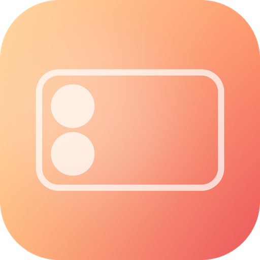

<p align="center"><a href="README.md">English</a> · <strong>简体中文</strong></p>

<div align="center">
  
  <h1>HyperRear</h1>
  <p><strong>小米 17 Pro 系列背屏上的音乐播放器，所有应用都能用。</strong></p>
  <p>
    <a href="https://t.me/HyperMusicCoverEnhanced"></a>
    <a href="https://t.me/HyperMusicCoverEnhancedChannel"></a>
    <a href="LICENSE"></a>
  </p>
</div>

> [!IMPORTANT]
> HyperRear 是 **[HyperMusicCover-Enhanced](https://github.com/Lewewe/HyperMusicCover-Enhanced)** 的扩展，还在早期开发中，暂时没有发布版本。

播放音乐时在背屏下滑，原本出现的是小米自带的音乐卡片，而且只有系统名单里的应用才有。HyperRear 把这里换成了自己的播放器，任何播放音乐的应用都能用，封面动画也和 HyperMusicCover-Enhanced 一样。

## 功能

| | |
| --- | --- |
| 🎵 **所有播放器** | 任何播放音乐的应用都会显示卡片 |
| 🖼️ **封面** | 暂停时缩小，切歌时翻转，和 HyperMusicCover-Enhanced 一样 |
| 🎚️ **HyperOS 控件** | 系统自带的动画按钮和发光进度条，拖动进度条即可跳转 |
| 🎤 **歌词与频谱** | 都来自 HyperMusicCover-Enhanced。点歌词按钮，封面就换成歌词 |
| ⭕ **摄像头圆环** | 调音量时，上方摄像头周围会出现音量环。打开歌词时，进度条会变成下方摄像头周围的圆环 |
| 🌫️ **封面背景** | 卡片背后是当前封面的模糊效果 |

之后还会加入：背屏息屏显示的样式。

## 要求

- 小米 17 Pro（已测试）或 17 Pro Max（未测试），HyperOS 4
- 已解锁 Bootloader、Root 和 LSPosed
- 使用相同签名的 HyperMusicCover-Enhanced

## 构建与安装

```sh
./gradlew assembleRelease
```

1. 安装 APK，然后打开 HyperMusicCover-Enhanced，进入 **扩展**。
2. 按 HyperRear 卡片的提示操作：在 LSPosed 中启用，批准 **com.xiaomi.subscreencenter** 作用域，再让它重启背屏。
3. 播放音乐，在背屏下滑。

在 **扩展** 里的 HyperRear 页面，可以分别开关播放器、音量环和进度环。

## 状态

Alpha 版，已在小米 17 Pro 上测试。HyperRear 适配的是背屏应用的某一个版本，系统更新后可能暂时失效，等 HyperRear 跟进。失效时会回到系统原生卡片。

## 致谢

- [Lewewe](https://github.com/Lewewe)：开发

许可证：[AGPL-3.0](LICENSE)
